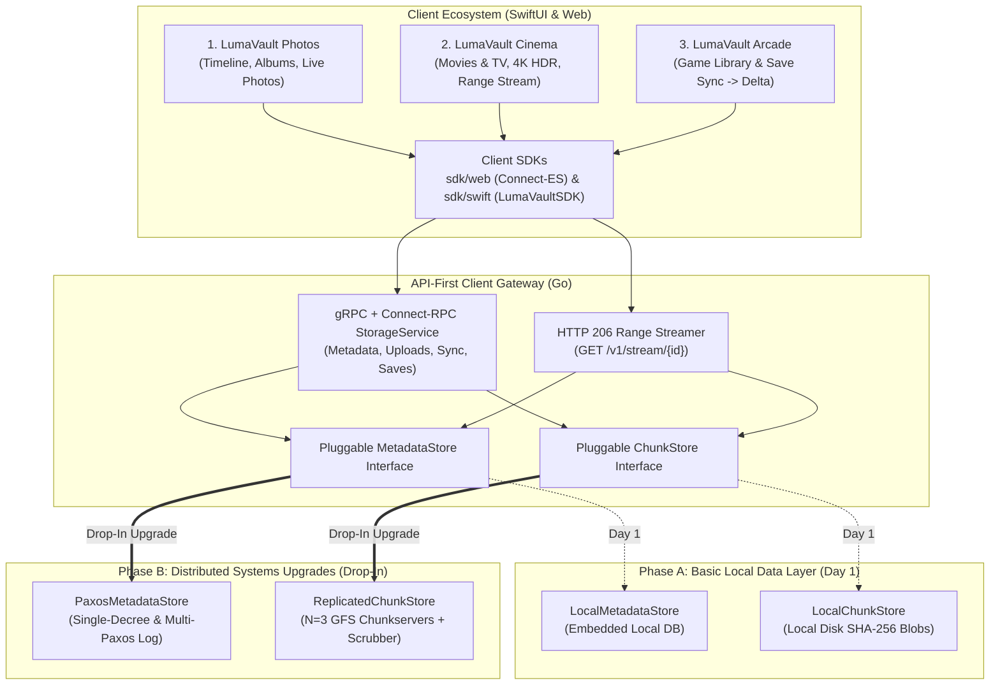

# LumaVault: Product & Architecture Blueprint

**LumaVault** is a self-hosted, distributed storage platform and client application suite (Apple ecosystem + Web) built to replace recurring cloud and media subscriptions (iCloud Photos, streaming services, and cloud game save tiers) while serving as a hands-on proving ground for distributed systems engineering (**Paxos**, replicated content-addressed chunk storage, and fault tolerance).

---

## 1. Core Architecture: The Google Stack

LumaVault follows the architectural lineage of **Google File System (GFS / Colossus)** and **Chubby (Multi-Paxos)**, organized in a single lightweight monorepo (`~/repos/lumavault`).

| Layer | Technology Choice | Purpose |
| :--- | :--- | :--- |
| **Monorepo & Codegen** | **Buf** (`buf.yaml`) + `Makefile` + `go.mod` + `Package.swift` + `package.json` | Single source of truth for `.proto` contracts; generates Go server code, Swift client SDK (`sdk/swift`), and Web/TypeScript SDK (`sdk/web`). |
| **Storage & Consensus Core** | **Go (Golang)** | High-concurrency network services, pluggable `MetadataStore` and `ChunkStore` interfaces, goroutine-based Paxos state machines, and high-throughput streaming. |
| **Internal Node-to-Node API** | **gRPC + Protocol Buffers (`proto3`)** | Strictly-typed, low-overhead binary RPCs for Paxos voting (`Prepare`/`Promise`/`Accept`/`Accepted`) and inter-node chunk replication. |
| **Client-Facing Gateway** | **gRPC + Connect-RPC + HTTP (`HTTP 206 Partial Content`)** | gRPC & Connect-RPC for metadata, chunk uploads, and library queries across Swift and Web; standard HTTP `Range: bytes=start-end` streaming (`GET /v1/stream/{id}`) for native `AVPlayer` and `<video>` 4K scrubbing. |
| **Client SDKs & Ecosystem** | **Web/TypeScript (`sdk/web`)** + **Swift/SwiftUI (`sdk/swift`)** | `@lumavault/sdk` (Connect-ES + Web Crypto SHA-256 chunking) for Web/Node and `LumaVaultSDK` Swift Package for `iOS`, `iPadOS`, `tvOS`, and `macOS`. |



---

## 2. Pluggable Data Layer: Basic First, Consensus Later

> [!IMPORTANT]
> **Two Narrow Backend Interfaces (`MetadataStore` + `ChunkStore`):**
> Rather than blocking SDKs and applications on distributed consensus, the Client Gateway talks strictly to two Go interfaces (`MetadataStore` for control-plane metadata and `ChunkStore` for content-addressed `SHA-256` data chunks). You start with a fast, local data layer (`LocalMetadataStore` + `LocalChunkStore`) and later drop in `PaxosMetadataStore` and `ReplicatedChunkStore` with zero changes to the Gateway, SDKs, or Apps.

### A. `ChunkStore` (The Data Plane: Chunking, Deduplication & Safety)
1. **Fixed-Size Content-Addressed Chunks:** Files are split into immutable chunks (e.g., 4MB–64MB) plus small thumbnail blobs. Each chunk is addressed by its `SHA-256` digest.
2. **Automatic Deduplication:** Identical chunks across duplicate photos, re-uploaded ROMs, or incremental game saves are uploaded and stored only once (`HasChunk` check before transfer).
3. **Day-1 `LocalChunkStore` (`pkg/chunkstore/`):** Stores verified `SHA-256` chunk files on local disk/storage volume and supports sub-chunk byte-range reads for `HTTP 206` streaming.
4. **Drop-In `ReplicatedChunkStore` (`pkg/chunkserver/`):**
   * **Replication Factor ($N = 3$):** Replicates each chunk across storage nodes over gRPC (`chunk.proto`).
   * **Bit-Rot Scrubbing:** Background workers periodically re-hash chunks on disk against their `SHA-256` identifier and heal corrupted blocks from healthy replicas.
   * **Garbage Collection:** Reclaims unreferenced `SHA-256` chunks when objects are deleted or uploads fail before commit.

### B. `MetadataStore` (The Control Plane: Object Manifests & Pluggable Paxos)
1. **Day-1 `LocalMetadataStore` (`pkg/metadata/`):** Persists object metadata, ordered chunk `SHA-256` manifests, Live Photo links (`live_photo_pair_id`), playback state (`playback_position_ms`), and monotonic game save versions (`v1`, `v2`, `v3`...) locally.
2. **Drop-In `PaxosMetadataStore` (`pkg/consensus/`):**
   * **Single-Decree Paxos ("Basic Paxos"):** Phase 1 (`Prepare` / `Promise`) and Phase 2 (`Accept` / `Accepted`) with proposal numbers `(round, node_id)` for safety under network partitions and node crashes.
   * **Multi-Paxos (Continuous Replicated Log):** Elected stable leader streams Phase 2 `Accept` messages for deterministic state machine replication across nodes (`CreateObject`, `CommitChunks`, `DeleteObject`), with log compaction/snapshotting so ephemeral updates never bloat the log unboundedly.

---

## 3. Client SDKs: Web (`sdk/web`) & Swift (`sdk/swift`)

Both SDKs are generated from `proto/lumavault/v1/storage.proto` via **Buf** and wrap the raw RPCs with ergonomic helpers:
1. **Web / TypeScript SDK (`sdk/web/` — `@lumavault/sdk`):**
   * Uses **Connect-ES (`@connectrpc/connect-web`)** to talk directly to the Go Gateway over standard HTTP/1.1 or HTTP/2 without requiring an Envoy proxy.
   * Uses the browser/Node **Web Crypto API (`crypto.subtle.digest('SHA-256', ...)`** to slice files, check existing chunks, upload missing chunks, and commit objects.
   * Provides URL helpers for `<video>` / `<audio>` `HTTP 206` range streaming.
2. **Swift SDK (`sdk/swift/` — `LumaVaultSDK`):**
   * Native Swift Package (`async`/`await`) supporting `iOS`, `iPadOS`, `tvOS`, and `macOS`.
   * Uses Apple `CryptoKit` (`SHA256`) for background chunk slicing and deduplicated uploads, plus `AVPlayer` stream URL helpers.

---

## 4. The Three Applications on Top of LumaVault

### App 1: LumaVault Photos (`NAMESPACE_PHOTOS`)
* **Goal:** A fast, reliable, subscription-free photo and personal video library.
* **Core Features:**
  * Chronological timeline browsing with thumbnail generation/caching, albums, camera/EXIF metadata inspection, and map view (`latitude`/`longitude`).
  * Native **Apple Live Photos** support (linking the `.HEIC` still and `.mov` video clip via `live_photo_pair_id`).
  * Automatic background upload with `SHA-256` deduplication so photos are never uploaded twice.

### App 2: LumaVault Cinema (`NAMESPACE_MOVIES_TV`)
* **Goal:** High-bitrate 4K HDR video streaming across **iPhone, iPad, Mac, Apple TV (`tvOS`), and Web**.
* **Core Features:**
  * Instant scrubbing on large 4K files via `GET /v1/stream/{object_id}` using `HTTP 206 Partial Content` byte-range requests across chunk boundaries (remuxed MP4/MOV for native `AVPlayer` / Web or `MPVKit`/`VLCKit` for raw `.mkv`).
  * Cross-device playback state sync (`playback_position_ms` stored in LumaVault metadata so you can pause on Apple TV and resume on iPad or Web).
  * Rich poster art, cast lists, season/episode grouping, and descriptions powered by the **TMDB API**.

### App 3: LumaVault Arcade (`NAMESPACE_GAMES`)
* **Goal:** A dedicated game library & save state manager integrating with **Delta** (or RetroArch/PPSSPP/Web emulators).
* **Core Features:**
  * Console-grade library UI with box art and metadata via **IGDB**, organized by system (`GBA`, `NDS`, `N64`, `SNES`, `GBC`, `NES`).
  * **One-Tap Download & Handoff to Delta:** Fetches the ROM from LumaVault and hands it off to Delta (`com.rileytestut.Delta`) via iOS `FileProvider` extension / Share Sheet Open-In.
  * **Versioned Save Sync (`.sav` & `.svs`):** Every time you back up a battery save or save state, LumaVault creates a monotonically numbered version (`v1`, `v2`, `v3`...) linked to the parent ROM (`parent_rom_object_id`), protecting RPG saves against corruption or accidental overwrites.

---

## 5. Linear Roadmap & Project Structure

Work is organized in Linear under team **Lumavault (`LUM`)** across 6 Projects designed for parallel git worktree execution:

1. **`P-LUM-1` — 1. Core Backend, Contracts & Basic Data Layer**
   * `M1`: Monorepo & Buf Protobuf Contracts
   * `M2`: Basic Data Layer (`LocalMetadataStore` & `LocalChunkStore`)
   * `M3`: Client Gateway (gRPC/Connect + `HTTP 206` Range Streamer)
2. **`P-LUM-2` — 2. Client SDKs (Web/TypeScript & Swift)**
   * `M1`: Web / TypeScript SDK (`sdk/web`)
   * `M2`: Swift SDK (`sdk/swift`)
3. **`P-LUM-3` — 3. LumaVault Photos**
   * `M1`: Timeline Grid, Thumbnails & Deduplicated Upload
   * `M2`: Live Photos, Albums & EXIF/Map View
4. **`P-LUM-4` — 4. LumaVault Cinema**
   * `M1`: Media Library & TMDB Metadata Integration
   * `M2`: 4K `HTTP 206` Scrubbing & Cross-Device Playback Sync
5. **`P-LUM-5` — 5. LumaVault Arcade**
   * `M1`: Console Library & IGDB Metadata
   * `M2`: Delta Handoff & Versioned Save Sync (`.sav`/`.svs`)
6. **`P-LUM-6` — 6. Distributed Systems Upgrades (Paxos & Chunkservers)**
   * `M1`: Pluggable Multi-Paxos Consensus (`PaxosMetadataStore`)
   * `M2`: Replicated Chunkservers & Bit-Rot Scrubber (`ReplicatedChunkStore`)

---

## 6. Monorepo Directory Structure (`~/repos/lumavault`)

```text
lumavault/
├── AGENTS.md                         # AI agent & multi-worktree development rules
├── Makefile                          # build, test, run, proto, lint
├── buf.yaml                          # Protobuf module & linter configuration
├── buf.gen.yaml                      # Generates Go (gen/go), Swift (sdk/swift), Web (sdk/web)
├── go.mod                            # Go module: github.com/AgrawalVi/lumavault
├── Package.swift                     # Swift Package for iOS, iPadOS, tvOS, macOS
├── docs/
│   └── BLUEPRINT.md                  # Product & Architecture Blueprint
├── proto/
│   └── lumavault/v1/
│       ├── storage.proto             # Client-facing API (Photos, Cinema, Arcade)
│       ├── paxos.proto               # Node-to-node Paxos Consensus RPCs (Project 6)
│       └── chunk.proto               # Node-to-node Chunkserver replication RPCs (Project 6)
├── cmd/
│   └── lumavault/main.go             # Server binary entrypoint
├── pkg/
│   ├── metadata/                     # MetadataStore interface + Day-1 LocalMetadataStore
│   ├── chunkstore/                   # ChunkStore interface + Day-1 LocalChunkStore (SHA-256)
│   ├── gateway/                      # Client gRPC/Connect-RPC + HTTP 206 Range Gateway
│   ├── consensus/                    # Single-Decree & Multi-Paxos (PaxosMetadataStore)
│   └── chunkserver/                  # Replicated chunk storage & bit-rot scrubber
├── sdk/
│   ├── web/                          # Shared Web/TypeScript SDK (@lumavault/sdk)
│   └── swift/                        # Shared Swift client library (LumaVaultSDK)
└── apps/
    ├── photos/                       # App 1: LumaVault Photos
    ├── cinema/                       # App 2: LumaVault Cinema
    └── arcade/                       # App 3: LumaVault Arcade (Delta companion)
```
