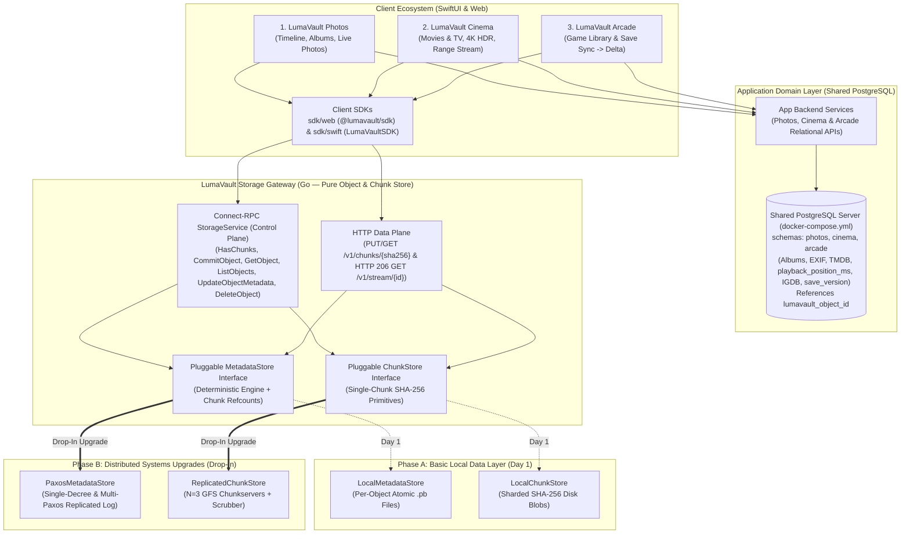

# LumaVault: Product & Architecture Blueprint

**LumaVault** is a self-hosted, distributed storage platform and client application suite (Apple ecosystem + Web) built to replace recurring cloud and media subscriptions (iCloud Photos, streaming services, and cloud game save tiers) while serving as a hands-on proving ground for distributed systems engineering (**Paxos**, replicated content-addressed chunk storage, and fault tolerance).

---

## 1. Core Architecture: The Google Storage Core + PostgreSQL Application Layer

LumaVault separates **pure distributed object/chunk storage** (modeled after **Google File System (GFS / Colossus)** and **Chubby (Multi-Paxos)**) from **application-layer relational domain logic** (backed by a shared **PostgreSQL** instance via Docker Compose at the monorepo root):

| Layer | Technology Choice | Purpose |
| :--- | :--- | :--- |
| **Monorepo & Codegen** | **Buf** (`buf.yaml`) + `Makefile` + `go.mod` + `Package.swift` + `package.json` | Single source of truth for `.proto` storage contracts; generates Go server code, Swift client SDK (`sdk/swift`), and Web/TypeScript SDK (`sdk/web`). |
| **Storage & Consensus Core** | **Go (Golang)** | Pure object & chunk storage engine: pluggable `MetadataStore` (deterministic `Engine` + per-object `<id>.pb` files -> Multi-Paxos) and `ChunkStore` (`SHA-256` blobs -> $N=3$ replicated chunkservers). |
| **Internal Node-to-Node API** | **gRPC + Protocol Buffers (`proto3`)** | Strictly-typed, low-overhead binary RPCs for Paxos voting (`Prepare`/`Promise`/`Accept`/`Accepted`) and inter-node chunk replication. |
| **Client-Facing Storage Gateway** | **Connect-RPC (`connectrpc/go`) + HTTP Data Plane (`PUT/GET /v1/chunks/{sha256}` & `HTTP 206`)** | Single `connectrpc/go` handler serving Connect, gRPC, and gRPC-Web for the Storage Control Plane (`HasChunks`, `CommitObject`, `GetObject`, `ListObjects`, `UpdateObjectMetadata`, `DeleteObject` — keeping all Protobuf messages `< 100 KB`); raw streaming HTTP for Data Plane chunk transfers (`PUT/GET /v1/chunks/{sha256}`) and `Range: bytes=start-end` streaming (`GET /v1/stream/{id}`) for native `AVPlayer` and `<video>` 4K scrubbing. |
| **Application Database Layer** | **PostgreSQL (`docker-compose.yml`) + App API Services** | Shared PostgreSQL server at the monorepo root with per-application schemas/tables (`photos`, `cinema`, `arcade`) storing rich relational domain data and high-frequency user state (Albums, EXIF, Live Photo pairing; TMDB catalog, seasons/episodes, and `playback_position_ms`; IGDB metadata, consoles, and monotonic game save version lineage `v1, v2, v3...`), referencing LumaVault `object_id` for immutable blob storage and streaming. |
| **Client SDKs & Ecosystem** | **Web/TypeScript (`sdk/web`)** + **Swift/SwiftUI (`sdk/swift`)** | `@lumavault/sdk` for Web/Node and `LumaVaultSDK` Swift Package for `iOS`, `iPadOS`, `tvOS`, and `macOS`. Internal design pending redesign. |



---

## 2. Pluggable Storage Core (`MetadataStore` + `ChunkStore`) vs. PostgreSQL Application DB

> [!IMPORTANT]
> **Pure Storage Core (`MetadataStore` + `ChunkStore`) + Relational Application Layer (`PostgreSQL`):**
> LumaVault's Go storage engine (`pkg/metadata`, `pkg/chunkstore`, `pkg/gateway`, `pkg/consensus`, `pkg/chunkserver`) is a **pure content-addressed object and chunk store**. It knows only about namespaces, object manifests (`id`, `namespace`, `filename`, `mime_type`, `size_bytes`, `chunk_size_bytes`, `sha256_digest`, `chunk_hashes`, `thumbnail_chunk_hash`, `created_at`, `updated_at`), and `SHA-256` chunks.
> All application-specific domain schemas, relational queries, and high-frequency user state (photo albums, EXIF, Live Photo links, TMDB movies/seasons/episodes, `playback_position_ms` watch heartbeats, IGDB game metadata, and monotonic save version lineage) live in the **shared PostgreSQL database**, referencing `lumavault_object_id`. This keeps the Multi-Paxos consensus log completely free of application query logic and high-frequency playback heartbeats.

### A. `ChunkStore` (The Data Plane: Chunking, Deduplication & Safety)
1. **Fixed-Size Content-Addressed Chunks (`4MB–64MB` over Raw HTTP):** Files are split into immutable `4MB–64MB` chunks (e.g. `4MB` for photos/ROMs/saves, up to `64MB` for 4K remuxes) plus small thumbnail blobs. Raw chunk bytes are streamed directly over HTTP (`PUT /v1/chunks/{sha256}` and `GET /v1/chunks/{sha256}`) in `32KB` buffers so Protobuf messages stay `< 100KB` and server RAM usage stays `~32KB` per upload. Each chunk is addressed by its `SHA-256` digest, and `chunk_size_bytes` is persisted on `ObjectMetadata` so `HTTP 206` byte-range seeks compute the target chunk index (`offset / chunk_size_bytes`) in $O(1)$ without statting disk files.
2. **Automatic Deduplication & 24h Lease Renewal:** Identical chunks across duplicate photos, re-uploaded ROMs, or incremental game saves are uploaded and stored only once (`HasChunks` check via Connect-RPC before transfer). Whenever `HasChunks` or `PutChunk` hits an existing chunk on disk, it touches the chunk's `mtime` (`os.Chtimes` to `time.Now()`) so resumed or deduplicated multi-chunk uploads receive a fresh 24-hour GC grace lease. In addition, `CommitObject` is idempotent on `(namespace, sha256_digest)` by default (unless `skip_dedup` is set, e.g., for distinct game save snapshots).
3. **Day-1 `LocalChunkStore` (`pkg/chunkstore/`):** Stores verified `SHA-256` chunk files in a sharded directory layout (`<rootDir>/chunks/<hash[0:2]>/<hash[2:4]>/<hash>`), supports `StatChunks` so the Gateway can verify exact chunk sizes (`0..N-2 == chunk_size_bytes`, tail chunk `== remaining bytes`) prior to `CommitObject`, and provides sub-chunk byte-range reads (`ReadChunkRange`) via `io.NewSectionReader` for `HTTP 206` streaming.
4. **Drop-In `ReplicatedChunkStore` (`pkg/chunkserver/`):**
   * **Replication Factor ($N = 3$):** Replicates each chunk across storage nodes over gRPC (`chunk.proto`).
   * **Bit-Rot Scrubbing:** Background workers periodically re-hash chunks on disk against their `SHA-256` identifier and heal corrupted blocks from healthy replicas.
   * **Predicate-Driven Garbage Collection:** Reclaims unreferenced `SHA-256` chunks whose `mtime` is older than a 24-hour grace window by querying `MetadataStore.IsChunkReferenced(hash)` in $O(1)$ time.

### B. `MetadataStore` (The Control Plane: Object Manifests & Pluggable Paxos)
1. **Deterministic `Engine` & Day-1 `LocalMetadataStore` (`pkg/metadata/`):**
   * **`metadata.Engine` (`pkg/metadata/engine.go`):** Pure deterministic in-memory state machine taking explicit `(objectID string, now time.Time)` inputs for validation, `(namespace, sha256_digest)` deduplication, cursor pagination, storage-level `FieldMask` updates (`filename`, `mime_type`, `thumbnail_chunk_hash`), and $O(1)$ chunk reference counting (`chunkRefs map[string]int`) powering `IsChunkReferenced(hash)`.
   * **`LocalMetadataStore` (`pkg/metadata/local.go`):** Wraps `Engine` with `sync.RWMutex` and persists one atomic binary Protobuf file per object (`<rootDir>/objects/<id>.pb`) via temporary staging files + `Sync()` + `os.Rename()`, rebuilding in-memory indexes and `chunkRefs` on startup.
2. **Drop-In `PaxosMetadataStore` (`pkg/consensus/`):**
   * **Single-Decree Paxos ("Basic Paxos"):** Phase 1 (`Prepare` / `Promise`) and Phase 2 (`Accept` / `Accepted`) with proposal numbers `(round, node_id)` for safety under network partitions and node crashes.
   * **Multi-Paxos (Continuous Replicated Log):** Elected stable leader streams Phase 2 `Accept` messages for deterministic state machine replication across nodes (`CommitObject`, `UpdateObjectMetadata`, `DeleteObject`) driving `metadata.Engine`, with log compaction/snapshotting.

---

## 3. Client SDKs: Web (`sdk/web`) & Swift (`sdk/swift`)

SDK design is being redone from scratch. Only the package scaffolding (`sdk/web/package.json`, `sdk/web/tsconfig.json`, `Package.swift`, and the Buf codegen targets) exists today. The SDK architecture will be specified here once the new design is approved.

---

## 4. The Three Applications on Top of LumaVault + Shared PostgreSQL

All three applications store their media blobs in **LumaVault Core** (`NAMESPACE_PHOTOS`, `NAMESPACE_CINEMA`, `NAMESPACE_GAMES`) via the Client SDKs while persisting their relational domain models and user state in the **shared PostgreSQL server** (`docker-compose.yml` at the monorepo root) referencing `lumavault_object_id`:

### App 1: LumaVault Photos (`NAMESPACE_PHOTOS`)
* **Goal:** A fast, reliable, subscription-free photo and personal video library.
* **Storage Core vs. PostgreSQL Split:**
  * **LumaVault Core:** Stores original photo/video chunks (`4MB–16MB`), server-generated `512px` thumbnail chunks (`thumbnail_chunk_hash`), and deduplicates identical uploads on `(NAMESPACE_PHOTOS, sha256_digest)`.
  * **PostgreSQL (`photos` schema):** Stores EXIF metadata (`taken_at`, `camera_make`, `camera_model`, `width`, `height`, `latitude`, `longitude`), **Apple Live Photo** pairing (`live_photo_pair_id` linking the `.HEIC` still `object_id` and `.mov` motion clip `object_id`), albums (`albums`, `album_items`), and two-stage deletion lifecycle (`ACTIVE` $\rightarrow$ `TRASHED` $\rightarrow$ `STAGED_FOR_DELETION`).

### App 2: LumaVault Cinema (`NAMESPACE_CINEMA`)
* **Goal:** High-bitrate 4K HDR video streaming across **iPhone, iPad, Mac, Apple TV (`tvOS`), and Web**.
* **Storage Core vs. PostgreSQL Split:**
  * **LumaVault Core:** Stores `64MB` 4K video chunks and serves instant keyframe scrubbing via `GET /v1/stream/{object_id}` using `HTTP 206 Partial Content` byte-range requests with $O(1)$ chunk index arithmetic (`offset / chunk_size_bytes`).
  * **PostgreSQL (`cinema` schema):** Stores **TMDB** catalog metadata (movies, TV series, seasons, episodes, cast, poster/backdrop URLs, durations) referencing `lumavault_object_id`, plus per-user cross-device playback state (`playback_position_ms`, "Continue Watching", watch history) updated via lightweight 10s heartbeats without touching LumaVault `ObjectMetadata` or the Paxos log.

### App 3: LumaVault Arcade (`NAMESPACE_GAMES`)
* **Goal:** A dedicated game library & save state manager integrating with **Delta** (or RetroArch/PPSSPP/Web emulators).
* **Storage Core vs. PostgreSQL Split:**
  * **LumaVault Core:** Stores immutable ROM files (deduplicated on `(NAMESPACE_GAMES, sha256_digest)`) and raw save blobs (`.sav` battery saves and `.svs` save states committed with `skip_dedup = true`).
  * **PostgreSQL (`arcade` schema):** Stores console systems (`GBA`, `NDS`, `N64`, `SNES`, `GBC`, `NES`), **IGDB** metadata and box art, ROM catalog entries (`rom_object_id`), and monotonically versioned save lineage (`parent_rom_id`, `save_object_id`, `save_version = 1, 2, 3...`, `save_kind`), powering one-tap ROM handoff to **Delta** (`com.rileytestut.Delta`) and instant point-in-time save rollback.

---

## 5. Linear Roadmap & Project Structure

Work is organized in Linear under team **Lumavault (`LUM`)** across 6 Projects designed for parallel git worktree execution:

1. **`P-LUM-1` — 1. Core Backend, Contracts & Basic Data Layer**
   * `M1`: Monorepo & Buf Protobuf Contracts (`storage.proto`, `Makefile`, multi-language codegen)
   * `M2`: Basic Data Layer (`LocalChunkStore` & `LocalMetadataStore` + deterministic `Engine`)
   * `M3`: Client Gateway (Connect-RPC Control Plane + HTTP Data Plane + Shared `docker-compose.yml` PostgreSQL setup)
2. **`P-LUM-2` — 2. Client SDKs (Web/TypeScript & Swift)**
   * Milestones to be re-scoped after the SDK redesign.
3. **`P-LUM-3` — 3. LumaVault Photos**
   * `M1`: Photos PostgreSQL Schema, Timeline Grid, Thumbnails & Deduplicated Upload
   * `M2`: Live Photos, Albums, Trash Lifecycle & EXIF/Map View
4. **`P-LUM-4` — 4. LumaVault Cinema**
   * `M1`: Cinema PostgreSQL Schema, Media Library & TMDB Metadata Integration
   * `M2`: 4K `HTTP 206` Scrubbing & Cross-Device Playback Sync (PostgreSQL Watch State)
5. **`P-LUM-5` — 5. LumaVault Arcade**
   * `M1`: Arcade PostgreSQL Schema, Console Library & IGDB Metadata
   * `M2`: Delta Handoff & Versioned Save Sync (`.sav`/`.svs`)
6. **`P-LUM-6` — 6. Distributed Systems Upgrades (Paxos & Chunkservers)**
   * `M1`: Pluggable Multi-Paxos Consensus (`PaxosMetadataStore`)
   * `M2`: Replicated Chunkservers & Bit-Rot Scrubber (`ReplicatedChunkStore`)

---

## 6. Monorepo Directory Structure (`~/repos/lumavault`)

```text
lumavault/
├── AGENTS.md                         # AI agent & multi-worktree development rules
├── Makefile                          # build, test, run, proto, lint
├── docker-compose.yml                # Shared PostgreSQL instance for Photos, Cinema & Arcade app schemas
├── buf.yaml                          # Protobuf module & linter configuration
├── buf.gen.yaml                      # Generates Go (gen/go), Swift (sdk/swift), Web (sdk/web)
├── go.mod                            # Go module: github.com/lumavault/lumavault
├── Package.swift                     # Swift Package for iOS, iPadOS, tvOS, macOS
├── docs/
│   └── BLUEPRINT.md                  # Product & Architecture Blueprint
├── proto/
│   └── lumavault/v1/
│       ├── storage.proto             # Client-facing Storage Core API (Pure Object & Chunk Manifests)
│       ├── paxos.proto               # Node-to-node Paxos Consensus RPCs (Project 6)
│       └── chunk.proto               # Node-to-node Chunkserver replication RPCs (Project 6)
├── cmd/
│   └── lumavault/main.go             # Storage Server binary entrypoint
├── pkg/
│   ├── constants/                    # Shared storage invariants (chunk size, SHA-256 hex length)
│   ├── metadata/                     # MetadataStore interface + deterministic Engine + LocalMetadataStore
│   ├── chunkstore/                   # ChunkStore interface + Day-1 LocalChunkStore (SHA-256)
│   ├── gateway/                      # Connect-RPC Control Plane + HTTP Data Plane (PUT/GET chunks & HTTP 206)
│   ├── consensus/                    # Single-Decree & Multi-Paxos (PaxosMetadataStore)
│   └── chunkserver/                  # Replicated chunk storage & bit-rot scrubber
├── sdk/
│   ├── web/                          # Shared Web/TypeScript SDK (@lumavault/sdk)
│   └── swift/                        # Shared Swift client library (LumaVaultSDK)
└── apps/
    ├── photos/                       # App 1: LumaVault Photos (Web, Apple & PostgreSQL photos schema)
    ├── cinema/                       # App 2: LumaVault Cinema (Web, Apple & PostgreSQL cinema schema)
    └── arcade/                       # App 3: LumaVault Arcade (Web, Apple & PostgreSQL arcade schema)
```
